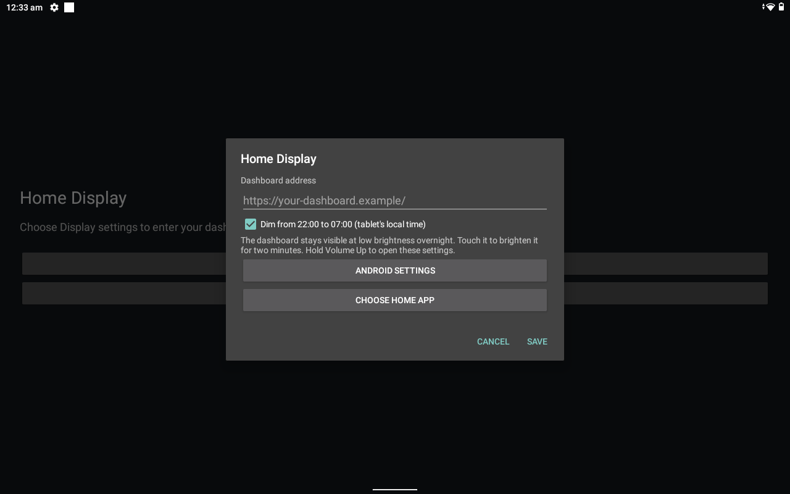

I went looking for a digital photo frame after watching [Wes Bos's photo-frame dashboard project](https://github.com/wesbos/photo-frame-dashboard). While shopping around, I found that a Lenovo tablet cost the same as the frames I was considering and gave me more powerful hardware. So I bought the tablet.

It's a little dated to use as a regular tablet, but it has more capacity than I need for a dashboard. That's fine. Maybe I'll find something useful for the extra power later. For now, I wanted a screen I could leave on, glance at and occasionally touch to control something in the house.

I used a Lenovo Tab M10, model **TB-X505F**, running Android 10. I kept stock Android and built a small WebView launcher with Codex. No root, bootloader unlock or replacement firmware was needed.

I've put the [launcher and a Home Assistant starter template on GitHub](https://github.com/bhekanik/android-home-display). You supply the dashboard address. The app handles displaying it full screen, keeping the screen awake, dimming overnight and recovering when the page fails to load.

## The model number matters more than the M10 name

Lenovo has sold several tablets under the M10 name. Mine is the TB-X505F with a 10.1-inch, 1280 × 800 display and a Micro-USB port. Other generations have different hardware and connectors, so check the model number before buying a cable, stand or dock. [Lenovo's specifications](https://psref.lenovo.com/syspool/Sys/PDF/Lenovo_Tablets/Tab_M10/Tab_M10_Spec.PDF) cover the differences within this family.

The useful parts for this project were already there: a touchscreen, Wi-Fi, a battery and an operating system that lets me install an app. I didn't need to work out how to unlock a frame before I could display a web page.

I wouldn't choose one solely on processor specifications, though. The charging port needs to work reliably, the battery needs to be in reasonable condition, and the browser needs to run your intended dashboard. A cheap tablet that keeps losing power will be a frustrating display regardless of how much memory it has.

The launcher requires Android 10 or newer. The TB-X505F is the physical device I've tested; that doesn't establish compatibility with every old Android tablet. If you already have one, try the page in its browser before buying anything else.

## Get the tablet and browser working before installing a launcher

I updated Chrome and Android System WebView through the Play Store. WebView is the browser component the Android app uses to render the dashboard. Updating Chrome alone isn't the check I care about; I want the component inside the app to work too.

Connect the tablet to Wi-Fi, set its date and timezone correctly, and open the dashboard in the ordinary browser. Sign in and try a control. If that fails, deal with it there first. Putting the same page inside a full-screen app won't fix an unreachable server or a broken login.

For USB setup, use a cable that carries data. I had to change cables while getting this tablet connected. A charging indicator only tells you it's getting power.

Enable Developer options by tapping Build number repeatedly in Android Settings, then enable USB debugging. Connect the tablet to your computer, keep it unlocked and approve the debugging prompt. With Android's platform tools installed, run:

```sh
adb devices -l
```

Your tablet should appear with the status `device`. If it says `unauthorized`, check the tablet for the approval prompt. If it doesn't appear at all, try a different data cable or USB port. Android's [physical device setup guide](https://developer.android.com/studio/run/device) covers the OS-specific steps, including drivers where needed.

## The launcher gives one web page a permanent home

We initially considered a kiosk app. I wanted to see whether a small app of our own would do the job, since the thing I wanted to display was already a web page.

The launcher is a Java Android app using the platform WebView. It loads a configured URL in landscape, hides the system bars and keeps the page's normal login cookies and site storage. It can also register as Android's Home app, so pressing Home returns to the dashboard.

It isn't a locked kiosk. Hold Volume Up and you can change the address, open Android Settings or choose another launcher. I wanted an easy way to maintain the tablet and get out of the app.

To build it, install Android Studio and use its SDK Manager to install Android SDK Platform 35 and Build Tools 35.0.0. The project uses Java 17 source compatibility. You can open the repository in Android Studio or build from a terminal with your JDK and Android SDK configured:

```sh
git clone https://github.com/bhekanik/android-home-display.git
cd android-home-display
./gradlew --no-daemon --max-workers=4 testDebugUnitTest assembleDebug lintDebug
```

Use `gradlew.bat` on Windows. The [repository's build instructions](https://github.com/bhekanik/android-home-display#build-the-launcher) cover the environment variables and SDK path.

The resulting debug APK is at `app/build/outputs/apk/debug/app-debug.apk`. Replace `YOUR_DEVICE_SERIAL` below with the tablet identifier from `adb devices -l`:

```sh
adb -s YOUR_DEVICE_SERIAL install -r app/build/outputs/apk/debug/app-debug.apk
adb -s YOUR_DEVICE_SERIAL shell am start -n com.bhekanik.homedisplay/.WallDisplayActivity
```

The public app asks for an address on first launch. Enter the full URL of a page you can already reach from the tablet. It can be a Home Assistant dashboard or your own hosted site. Don't put a password in the URL; sign in through the page.



Once that works, hold Volume Up, choose **Choose Home app**, and select **Home Display**. Press Home to check that it returns to the dashboard. You can leave the default launcher alone if you'd rather open Home Display like any other app.

The APK you build this way is a development build. Its WebView can be inspected through authorised ADB, which is useful while getting the page working. Disable USB debugging when you no longer need it. The launcher doesn't need a debugging connection to run.

## Home Assistant is an easy first page to put on it

I already use Home Assistant, so it gave me somewhere to start. You don't need to reproduce my dashboard to use the launcher.

The repository includes a [dashboard template](https://github.com/bhekanik/android-home-display/tree/main/home-assistant) with a clock, weather, calendar and a couple of room controls. It uses built-in Home Assistant cards. There are no custom cards or additional integrations to install for the layout itself.

You do need your own devices and calendar connected to Home Assistant. The template contains example entity IDs, which are the names Home Assistant uses to refer to things. Replace them with yours, or remove the cards you don't need.

Create a new dashboard from scratch in Settings → Dashboards. Open its raw configuration editor and paste in the edited template. This is a dashboard configuration, so it goes in that editor rather than the main `configuration.yaml` file. Creating a separate dashboard also lets you try it without replacing a view you already use. Home Assistant documents [creating and editing dashboards here](https://www.home-assistant.io/dashboards/dashboards/).

Check the result on the tablet, then copy that dashboard's URL into the launcher. I gave the display its own non-administrator Home Assistant account and signed in directly on the tablet. That keeps it separate from my normal session, but it still has permission to control devices. A non-administrator account isn't a read-only account.

I eventually built a custom React interface because I wanted more control over the design. It uses Home Assistant's APIs underneath. That's an option you can take later; the launcher still just loads a URL. Changing the web page doesn't require rebuilding the Android app.

## Keeping it awake and making it dim are separate jobs

The tablet went dark while my dashboard was open. The app now uses Android's [`FLAG_KEEP_SCREEN_ON`](https://developer.android.com/develop/background-work/background-tasks/awake/screen-on), which keeps the screen awake while the activity is visible. It doesn't override the power button, bypass the lock screen or keep another app awake after you switch away.

I also wanted the screen to be less bright at night. The launcher has an overnight option that dims to 8% from 22:00 to 07:00 in the tablet's local timezone. Its normal brightness is 45%. Touching the display brings it back to that brightness for two minutes, then it dims again. The page stays visible and continues running.

These are defaults in the app, not a universal prescription for a room. You can turn the schedule off in Display settings or change the values in the source. Android's own charging screensaver may need to be disabled if it takes over the display.

My custom web page has a moving screensaver too, but the shared launcher doesn't include it. Keeping the panel awake is the Android app's job. Deciding what to draw, including any screensaver, belongs to the page.

## Test it on a desk before finding it a permanent spot

After installation, you can disconnect the tablet from the computer and power it from an appropriate charger. The computer isn't running the Android app. The dashboard server still needs to be available, though. If you host the page on your laptop, putting that laptop to sleep can make the display stop working.

Try disconnecting and reconnecting Wi-Fi. The launcher shows a retry screen when the main page fails, backs off between attempts and retries when the network returns. It also replaces a crashed WebView renderer. A loaded dashboard has to handle its own data connection failures, so check that values resume updating too, rather than stopping at "the page is visible."

Try closing and reopening the app, pressing Home, sleeping and waking the tablet, and rebooting it. Don't assume that making an app the default launcher bypasses the device's lock screen after a reboot. Keep a way to unlock and maintain the tablet.

I enabled the Lenovo's Battery Protect Mode, whose description on this unit says charging pauses at 60%. I still need a longer trial on the intended power supply to establish how the battery and temperature behave. I've tested the app running and recovering; I haven't proved months of unattended use. Check the battery and port physically, and leave room for ventilation when choosing a mount.

To return to normal tablet use, hold Volume Up, choose **Choose Home app**, and select the original launcher. Keep that launcher installed. There's no firmware change to reverse.

The same-price tablet was a useful find for this project. I have a home display now and some hardware capacity left over. I'll find out what else I want it to do by using it.
